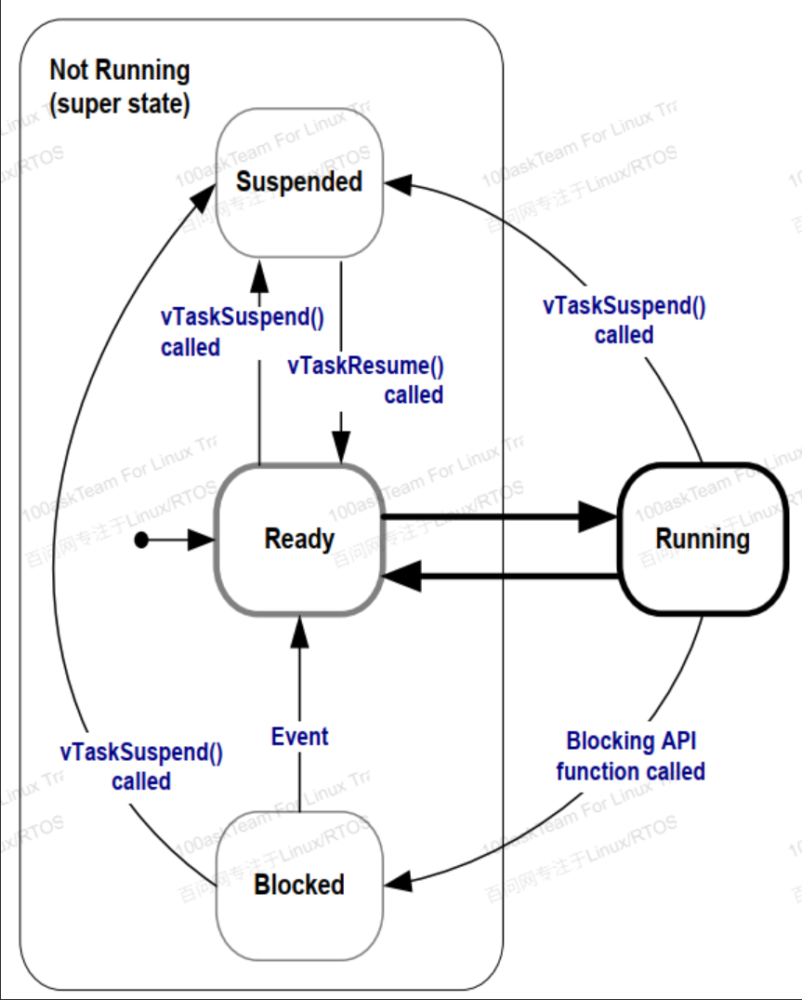

# Freerots-Kernel学习

## 列表


任务运行在就绪状态，阻塞状态，挂起状态等都是通过链表来管理的。每个任务都有一个链表节点，节点中存储了任务的优先级，任务的状态等信息。

```c
struct xLIST; 
struct xLIST_ITEM
{

    configLIST_VOLATILE TickType_t xItemValue;          /*< 升序 */
    struct xLIST_ITEM * configLIST_VOLATILE pxNext;     /*< 下指针. */
    struct xLIST_ITEM * configLIST_VOLATILE pxPrevious; /*< 上指针 */
    struct xLIST * configLIST_VOLATILE pxContainer;     /*< 指向所在的列表 */

};
typedef struct xLIST_ITEM ListItem_t;                   

```
列表结构体

**哨兵***：一个"标记边界/终止"的特殊结构体，用来标记链表的开始和结束。它不存储实际的数据，只是作为链表的边界标记。哨兵节点的存在使得链表操作更加简化，因为在插入或删除节点时，不需要检查是否到达链表的头部或尾部。
**pxIndex**：当前运行任务的索引，指向链表中当前任务的位置。它用于在链表中遍历和操作任务节点。下次任务切换时，pxIndex会指向下一个任务节点，从而实现任务的轮转调度。
```c
typedef struct xLIST
{
    listFIRST_LIST_INTEGRITY_CHECK_VALUE 
    volatile UBaseType_t uxNumberOfItems;     //记录当前链表里挂了多少个有效节点
    ListItem_t * configLIST_VOLATILE pxIndex; //当前运行任务的索引
    MiniListItem_t xListEnd;                  //哨兵，环形链表的尾部，如果pxNext=xListEnd说明是最后一个元素了，pxPrevious=xListEnd说明是第一个元素了            
    listSECOND_LIST_INTEGRITY_CHECK_VALUE     
} List_t;
在freertos中有各种各样的链表来表示，各种状态的任务：
```c
// task.c

PRIVILEGED_DATA static List_t pxReadyTasksLists[ configMAX_PRIORITIES ]; /*< Prioritised ready tasks. */
PRIVILEGED_DATA static List_t xDelayedTaskList1;                         /*< Delayed tasks. */
PRIVILEGED_DATA static List_t xDelayedTaskList2;                         /*< Delayed tasks (two lists are used - one for delays that have overflowed the current tick count. */
PRIVILEGED_DATA static List_t * volatile pxDelayedTaskList;              /*< Points to the delayed task list currently being used. */
PRIVILEGED_DATA static List_t * volatile pxOverflowDelayedTaskList;      /*< Points to the delayed task list currently being used to hold tasks that have overflowed the current tick count. */
PRIVILEGED_DATA static List_t xPendingReadyList;                   

```

列表初始化
```c
void vListInitialise( List_t * const pxList )
{
    
    pxList->pxIndex = ( ListItem_t * ) &( pxList->xListEnd ); /*lint !e826 !e740 !e9087 The mini list structure is used as the list end to save RAM.  This is checked and valid. */

    listSET_FIRST_LIST_ITEM_INTEGRITY_CHECK_VALUE( &( pxList->xListEnd ) );

    pxList->xListEnd.xItemValue = portMAX_DELAY;//由于列表是空的且状态列表是顺序表，一般将他设置为最大值

    /* The list end next and previous pointers point to itself so we know
     * when the list is empty. */
    pxList->xListEnd.pxNext = ( ListItem_t * ) &( pxList->xListEnd );     /*lint !e826 !e740 !e9087 The mini list structure is used as the list end to save RAM.  This is checked and valid. */
    pxList->xListEnd.pxPrevious = ( ListItem_t * ) &( pxList->xListEnd ); /*lint !e826 !e740 !e9087 The mini list structure is used as the list end to save RAM.  This is checked and valid. */


    pxList->uxNumberOfItems = ( UBaseType_t ) 0U;

    /* Write known values into the list if
     * configUSE_LIST_DATA_INTEGRITY_CHECK_BYTES is set to 1. */
    listSET_LIST_INTEGRITY_CHECK_1_VALUE( pxList );
    listSET_LIST_INTEGRITY_CHECK_2_VALUE( pxList );
}

```

### 任务切换



在 FreeRTOS 中，任务切换是通过 PendSV 异常来实现的。PendSV 是一个可挂起的异常，它的优先级通常设置为最低，以确保它在所有其他中断处理程序之后执行。任务切换的过程如下：
在每个Systick周期中，系统会调用 `xPortSysTickHandler` 函数，该函数会增加系统的 tick 计数，检查是否xDelayedTaskList数组是否有任务需要从延迟状态切换到就绪状态。如果有，就会触发 PendSV 异常，进行任务切换。

切换逻辑，每个节拍周期都会进入`xPortSysTickHandler`,`xTaskIncrementTick`会递增节拍计数器，延时列表检查、时间片轮转判断等，判断是否触发PendSV中断，pendsv中触发`vTaskSwitchContext`将pxcurrenttcb修改成当前最高的优先级的任务，切换任务，
```c
void xPortSysTickHandler( void )
{

    vPortRaiseBASEPRI();//屏蔽掉优先级低于或等于 configMAX_SYSCALL_INTERRUPT_PRIORITY
    {

        if( xTaskIncrementTick() != pdFALSE )
        {
          
            portNVIC_INT_CTRL_REG = portNVIC_PENDSVSET_BIT;  //触发PendSV中断
        }
    }

    vPortClearBASEPRIFromISR();
}

```

通过 TCB 指针，可以读取任务的栈指针、寄存器上下文、优先级等内部字段
```c
typedef struct tskTaskControlBlock       /* The old naming convention is used to prevent breaking kernel aware debuggers. */
{

    volatile StackType_t * pxTopOfStack; /*< Points to the location of the last item placed on the tasks stack.  THIS MUST BE THE FIRST MEMBER OF THE TCB STRUCT. */
    ListItem_t xStateListItem;                  /*< The list that the state list item of a task is reference from denotes the state of that task (Ready, Blocked, Suspended ). */
    ListItem_t xEventListItem;                  /*< Used to reference a task from an event list. */
    UBaseType_t uxPriority;                     /*< The priority of the task.  0 is the lowest priority. */
    StackType_t * pxStack;                      /*< Points to the start of the stack. */
    char pcTaskName[ configMAX_TASK_NAME_LEN ]; /*< Descriptive name given to the task when created.  Facilitates debugging only. */ /*lint !e971 Unqualified char types are allowed for strings and single characters only. */

} tskTCB;
```


```c
void vTaskSwitchContext( void )
{
    if( uxSchedulerSuspended != ( UBaseType_t ) pdFALSE )
    {
        /* The scheduler is currently suspended - do not allow a context
         * switch. */
        xYieldPending = pdTRUE;
    }
    else
    {
        xYieldPending = pdFALSE;
        traceTASK_SWITCHED_OUT();

        /* Check for stack overflow, if configured. */
        taskCHECK_FOR_STACK_OVERFLOW();


        /* Select a new task to run using either the generic C or port
         * optimised asm code. */
        taskSELECT_HIGHEST_PRIORITY_TASK(); /*lint !e9079 void * is used as this macro is used with timers and co-routines too.  Alignment is known to be fine as the type of the pointer stored and retrieved is the same. */
        traceTASK_SWITCHED_IN();

    }
}

```
汇编中加！代表回写 源地址-写入的个数*4，当这个中断触发时硬件会自动保存r0-r3 r12，
这个函数首先保存之前任务的现场，保存相对应的寄存器，在进入临界区，vTaskSwitchContext修改pxCurrentTCB全局变量，然后就能获得即将进行任务的栈顶，和栈地址，就可以从这开始运行了
```c

__asm void xPortPendSVHandler( void )
{
    extern uxCriticalNesting;
    extern pxCurrentTCB;
    extern vTaskSwitchContext;

/* *INDENT-OFF* */
    PRESERVE8  //要求八字节对齐

    mrs r0, psp
    isb //刷新处理器流水线

    //r3 = &pxCurrentTCB 
    //r2 = *r3
    ldr r3, =pxCurrentTCB //获取了当前Tcb指针
    ldr r2, [ r3 ] 

    stmdb r0 !, { r4 - r11 } /* 手动存储r4-r11的寄存器 */
    str r0, [ r2 ] /* Save the new top of stack into the first member of the TCB. */

    stmdb sp !, { r3, r14 }
    mov r0, #configMAX_SYSCALL_INTERRUPT_PRIORITY
    msr basepri, r0 //BASEPRI（基优先级）特殊寄存器 频闭#configMAX_SYSCALL_INTERRUPT_PRIORITY比他高的
    dsb
    isb
    bl vTaskSwitchContext //获取到即将运行任务的tcb
    mov r0, #0
    msr basepri, r0 
    ldmia sp !, { r3, r14 }

    ldr r1, [ r3 ]
    ldr r0, [ r1 ] /* The first item in pxCurrentTCB is the task top of stack. */
    ldmia r0 !, { r4 - r11 } /* Pop the registers and the critical nesting count. */
    msr psp, r0
    isb
    bx r14 
    nop
/* *INDENT-ON* */
}

```
### 阻塞延迟

普通延迟会占用cpu，阻塞延迟不会，会把cpu让出去
阻塞链表有两个，一个是不溢出的一个是溢出的，当Systick计数器溢出时两个会互换，为了解决当计数器溢出时，会从零开始这个时候，调度器会误以为他的延迟时间到了，该运行了，prvAddCurrentTaskToDelayedList( xTicksToDelay, pdFALSE )核心，还有这个变量xNextTaskUnblockTime，更新最早开始所需要的时间，小于她时不会检查是否有就绪的任务

### 队列


